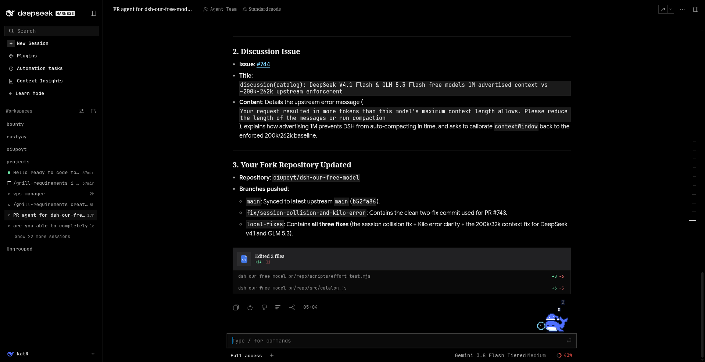
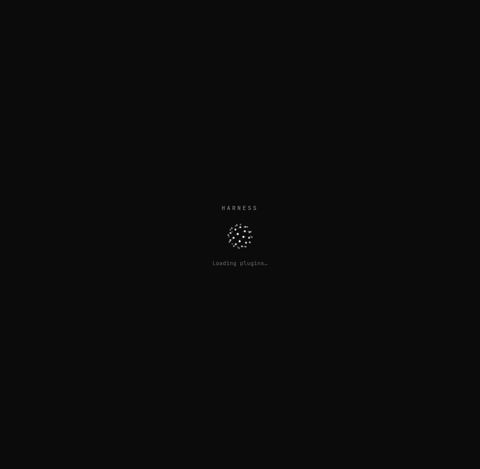
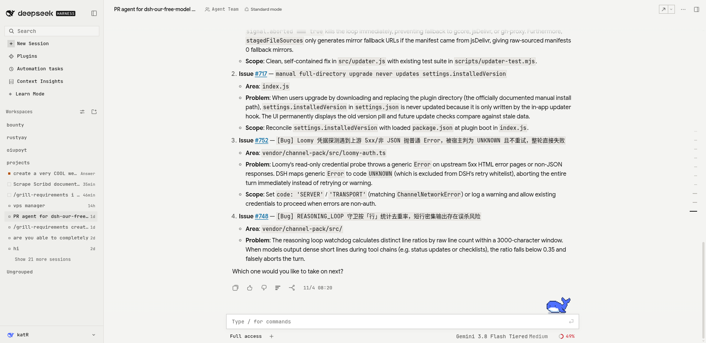

# custom-dsh-theme

A personal theme for the DeepSeek Harness web GUI. Not a product, not a
marketplace plugin, and not affiliated with DeepSeek.

Black, square, mono, quiet.

## What it changes

- **Colour.** A soft black ground (`#0b0b0c`) with `#141417` panels and
  `#2a2b31` hairlines, because pure black flattens every raised surface into
  one void at full-screen size. Settings, **Black**, swaps the whole ramp:
  **Amoled** (pure `#000000`), **Soft** (the default neutral charcoal) and
  **Warm** (a brown-leaning black). Sky is the default accent; emerald and a
  plain mono variant are one click away.
- **Shape.** Every corner is square, enforced on every element and pseudo
  element, because the host exposes no radius token for most of its surfaces.
- **Type.** JetBrains Mono for chrome and code. Answer text stays in a neutral
  sans unless you switch it to mono.
- **Motion.** Calm by default: chrome loops stop, one-shot transitions stay
  snappy. Progress indicators keep spinning so loading never looks finished.
- **Thinking orb.** Working sessions, the boot screen and the composer mascot
  show a dotted orb. Two states: a Fibonacci sphere turned about a tilted axis,
  and the *working* state - three rings, each on its own tilt and speed, so a
  running session reads as a mechanism doing something rather than a ball of
  dots. Rows and the boot splash use the working state; the composer mascot
  uses the sphere. Three sizes (18px rows, 56px boot, 89px composer), ink read
  from the label token, DPR capped at 2, paused off-screen, and a still frame
  under reduced motion. Drawn on a plain 2D canvas, inspired
  by [thinking-orbs](https://rareformlabs.github.io/thinking-orbs/) (MIT, Jakub
  Antalik); no runtime dependency, so the bundle stays one file.
- **Composer mascot.** The DeepSeek whale above the prompt box is replaced by
  the orb, drawn where the sprite was. Only the sprite is hidden: the host
  element and its click target stay, so the mascot's bubble still works. That
  orb is the playful one - it bobs on its own rhythm, breathes a few percent
  and sheds sparks.
- **List spacing.** A session row reserves a status-light column only when it
  has a status light. Idle rows collapse that column instead of showing a hole,
  so the list reads ragged-left where it used to read as broken.
- **Top bar.** One compact band: the session title, mode chips and utility
  icons on a 32px row, the view tabs on a 32px rail below it, one hairline
  under the band, mono labels, and a single accent underline on the active tab.
- **Header.** The image-gen "Gallery" chip is hidden. The plugin stays mounted
  and keeps its tools and its Image Studio entry point.

Both light and dark are supported. Dark is the intended look.





## Install

```sh
dsh plugin --profile web add /absolute/path/to/custom-dsh-theme
```

Then reload the page. The theme appears in Settings under **Custom DSH Theme**.

If `dsh` cannot find `pnpm`, point it at yours for that one command:

```sh
PATH="$HOME/.npm-global/bin:$PATH" dsh plugin --profile web add /absolute/path/to/custom-dsh-theme
```

## Remove

```sh
dsh plugin --profile web remove custom-dsh-theme
```

The theme's preferences live in `localStorage` under `custom-dsh-theme.prefs`
and are ignored once the bundle is gone. Clear that key to start fresh.

## Settings

| Control | Values | Effect |
| --- | --- | --- |
| Accent | Sky, Emerald, Mono | Recolours buttons, links, focus rings and selected marks |
| Density | Comfortable, Compact | Prose rhythm and list-row padding only, never a layout change |
| Motion | Calm, Full | Calm stops decorative loops; Full hands motion back to claude-style |
| Prose | Sans, Mono | Typeface of answer text |
| Reset | | Back to defaults and clears the stored preference |

## Notes

- Works with `dsh-claude-style` disabled. It only writes documented host
  tokens, so an upgrade of either plugin degrades to "less tuning", never to a
  broken page.
- No bundler, no build step, no dependencies. `client.js` is loaded as-is.
- Tests: `node --test`

## Top bar

The top bar is drawn by the host header plus this theme. It assumes two Claude
Style switches are OFF, under **Settings, Claude Style, Conversation**:

- **Chat / Trajectory tabs**
- **Header in the title bar**

Both lift the tab strip onto the title line and move it with a computed offset.
With more than two views that produced floating, clipped tabs. Turned off, the
host draws its own two rows, and this theme makes them one compact band: a 32px
title row, a 32px view-tab rail, a 1px hairline bottom border, mono labels, and
one accent underline on the active tab. Every registered view shows inline; the
"More conversation views" menu was removed at the host bundle level (see Host
top-bar override below).

The image-gen gallery-chip rule in the stylesheet is a fallback: the installed
image-gen client also carries a `__DSH_HIDE_IMAGE_GALLERY__` flag, so the chip
stays gone even if load order changes. `generate_image` is unaffected.

## Host top-bar override

DSH 0.2.2-rc.1 hides Conversation View tabs behind a "More conversation views"
menu and caps the visible tabs by header width. To keep Chat, Trajectory,
Context, Web, Fleet and any other registered view inline, the conversation
region registration was removed from the installed host bundle:

```
~/.npm-global/lib/node_modules/@deepseek-ai/dsh/node_modules/@deepseek-ai/dsh-client-ui-entry-customization/lib/client.js
```

That file is outside this package, so a DSH upgrade restores the folding. The
workspace guard test `projects/tests/dsh-topbar.test.mjs` fails when either this
override or the gallery-chip rule is lost:

```sh
node "/home/oiupoyt/my stuff yea/projects/tests/dsh-topbar.test.mjs"
```

